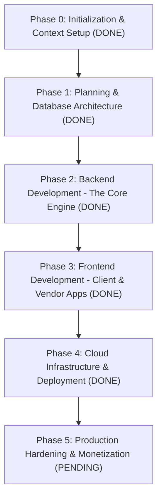

# PROJECT KNOWLEDGE BASE & MEMORY BANK

---

## 1. Executive Summary & Business Context

We are building a scalable, high-performance Online Travel Agency (**OTA**) platform targeting an initial beta of 200 users, architected from the ground up for high concurrency, data integrity, and modular scalability.

### Core Value Proposition & Dual User Journey
The platform enforces a strict domain and UI/UX separation between two distinct travel booking paradigms:
1. **Hotel Reservations (Transactional / Velocity-driven):**
   * Optimized for speed, low-friction discovery, and immediate conversion.
   * Target audience: Business travelers, short city stays, transit bookings.
   * Key characteristics: Strict date-range filtering, rapid sorting (price, proximity, rating), one-click checkout.
2. **Resort Reservations (Immersive Vacation Planning + Local Guide Bundles):**
   * Rich media, amenity-focused vacation planning.
   * **Local Guide Bundling:** First-class integration allowing users to browse certified local tour guides (identity, bio, languages, hourly/daily fees, review ratings, experience highlights) and attach/bundle them directly to their resort booking reservation in a single checkout flow.

### MVP Inventory Model
* **Vendor Allocation Model:** Vendors/hosts allocate a fixed block of room inventory directly into our database (`room_allocations`). This eliminates complex, latency-heavy two-way GDS (Global Distribution System) real-time syncing for the MVP phase while ensuring zero overbooking via strict database-level transactional concurrency (`SELECT ... FOR UPDATE` with `CHECK (booked_count <= total_allocated)`).

### Interfaces & Target Personas
1. **Consumer Mobile Application (Cross-Platform / Flutter):** Dual-path search (Hotels vs. Resorts), Mapbox interactive map explorer, guide bundling interface, checkout & reservation tracking.
2. **Vendor Management Portal (Web):** Inventory allocation matrix, pricing rules, guide profile management, booking reconciliation.
3. **Internal Admin Dashboard (Web):** User management, platform fee configuration, vendor vetting/approvals, guide certification oversight, system telemetry.

---

## 2. Technology Stack & Technical Constraints

| Layer | Technology | Rationale & Architectural Choice |
| :--- | :--- | :--- |
| **Backend Framework** | Python 3.11+ / FastAPI | High asynchronous throughput (ASGI / `uvloop`), native Pydantic v2 validation, auto-generating OpenAPI schemas. |
| **Database** | PostgreSQL 15+ | Strict relational constraints, robust ACID transactional guarantees for booking locks, spatial query readiness. |
| **ORM / Migrations** | SQLAlchemy 2.0 (Async) + Alembic | Modern async I/O database communication, strict typed models, deterministic schema migrations. |
| **Mapping Engine** | Mapbox GL SDK / Mapbox APIs | Cost-effective vector tiles, smooth 60fps mobile rendering, custom markers for hotels vs. resorts & guide hotspots. |
| **Client Frontend** | Flutter (Dart) | Single codebase for native iOS/Android performance, custom rendering engine for smooth split-flow UX. |
| **Vendor/Admin Web** | Modern Lightweight Web (HTML5/Tailwind/ES6) | Fast responsive data grids, inventory management tables, analytics views. |
| **Container & Infra** | Docker, Docker Compose, Nginx, Linux | Repeatable environments, isolated service boundaries, zero-drift local-to-production deployment. |

---

## 3. Project Roadmap & Sequential Phasing Tracker

### Current Phase: **Phase 5: Production Hardening & Monetization**



| Phase | Description | Deliverables | Status |
| :--- | :--- | :--- | :--- |
| **Phase 0** | **Initialization & Context Setup** | Context Memory Bank (`PROJECT_KNOWLEDGE.md`), project standards, tech stack alignment. | **COMPLETED** |
| **Phase 1** | **Planning & Database Architecture** | Entity-Relationship (ER) design, PostgreSQL schema (raw SQL + SQLAlchemy 2.0 models), indexes, transactional lock design, seed data. | **COMPLETED** |
| **Phase 2** | **Backend Development (The Core Engine)** | FastAPI modular app, separated Hotel vs. Resort query pipelines, Guide Bundling engine, Allocation inventory locks, 100% passing test suite. | **COMPLETED** |
| **Phase 3** | **Frontend Development (Client & Web)** | Mobile UI (Flutter), dual-path search UI, Mapbox integration, Vendor/Admin portal interfaces. | **COMPLETED** |
| **Phase 4** | **Cloud Infrastructure & Deployment** | Multi-stage Dockerfiles, Docker Compose orchestrations, `.env` config templates, deployment scripts. | **COMPLETED** |
| **Phase 5** | **Production Hardening & Monetization** | Stripe payments, transactional emails, Alembic DB migrations, security lockdown (CORS, Secrets), and Consumer 'My Trips' wiring. | **PENDING** |

---

## 4. Architectural Decision Records (ADRs)

### ADR-001: Dual-Pipeline Domain Separation (Hotels vs. Resorts)
* **Status:** Accepted
* **Decision:** Implement dedicated domain services and query pipelines (`HotelService` vs. `ResortService`) sharing core inventory/booking primitives but maintaining decoupled presentation and aggregation layers.

### ADR-002: Vendor Room Allocation Model for MVP
* **Status:** Accepted
* **Decision:** Implement an allocation inventory model where partner properties assign fixed room quotas to our platform. Inventory deduction utilizes database row-level locking (`SELECT ... FOR UPDATE`) or atomic decrement constraints to guarantee zero overbooking during concurrent booking spikes.

### ADR-003: Mapbox for Spatial Rendering & Geocoding
* **Status:** Accepted
* **Decision:** Standardize on Mapbox SDKs for vector tile map displays, custom property pin clustering, and bounding-box queries (`min_lat`, `max_lat`, `min_lon`, `max_lon`).

### ADR-004: Async FastAPI + PostgreSQL Stack
* **Status:** Accepted
* **Decision:** Python FastAPI with async SQLAlchemy against PostgreSQL. Leverages connection pooling, non-blocking I/O for external integrations, and strict relational foreign keys/check constraints.

### ADR-005: Persistent Context Retention via `PROJECT_KNOWLEDGE.md`
* **Status:** Accepted
* **Decision:** Maintain `PROJECT_KNOWLEDGE.md` as the single source of truth (SSOT). Every phase boundary strictly requires synchronizing completed deliverables, next steps, and ADRs.

### ADR-006: Composite Reservation Model with Bundled Guide Items
* **Status:** Accepted
* **Decision:** Model bookings with a parent `reservations` table and child line items: `room_booking_items` and `guide_booking_items`. The parent reservation holds overall financial aggregates, state machine transitions, and idempotency locks.

### ADR-007: Pessimistic Row-Level Locking on Allocation & Guide Calendars
* **Status:** Accepted
* **Decision:** Execute booking operations inside an explicit database transaction using `SELECT FOR UPDATE` on `room_allocations` and `guide_availabilities`. Database check constraints (`booked_count <= total_allocated`) act as safety nets.

### ADR-008: Dual-Pipeline REST API Implementation
* **Status:** Accepted
* **Decision:** Expose `/api/v1/hotels` for rapid geo-proximity/price sorting and `/api/v1/resorts` for experiential search with preloaded certified guide rosters.

### ADR-009: Pre-Checkout Quote and Atomic Allocation Checkout
* **Status:** Accepted
* **Decision:** Implement `/api/v1/bookings/quote` for real-time price estimation (rooms + guide + 5% platform fee + 8.5% lodging tax) prior to executing `/api/v1/bookings` transactional commitment.

### ADR-010: Client-Side Dual-Path Segmented Journey Navigation
* **Status:** Accepted
* **Decision:** The consumer Flutter mobile application enforces a persistent segmented control separating the **City Hotels** journey (fast transactional discovery with Mapbox list/map toggle) from the **Resorts & Guides** journey (curated luxury imagery, experience filters, and resident guide rosters).

### ADR-011: Modal Sheet & Roster UI for Local Guide Bundling
* **Status:** Accepted
* **Decision:** Resort detail views display certified resident tour guides with 1-tap bundle selection. Guide cards provide interactive modals (`GuideBundleSheet`) displaying credentials, spoken languages, specialties, daily rates, and verified badges.

### ADR-012: Multi-Container Micro-Architecture via Docker Compose
* **Status:** Accepted
* **Decision:** Containerize the ecosystem into dedicated, decoupled services: `db` (PostgreSQL 15 with healthcheck and automatic schema/seed bootstrapping), `api` (multi-stage non-root FastAPI image), and `web` (Nginx reverse proxy and static portal web server).

### ADR-013: Target Testing Strategy & Device Emulation
* **Status:** Accepted
* **Decision:**
  1. **Mobile Application (`mobile_app`):** To avoid the heavy CPU/RAM virtualization overhead of Android Studio's standard QEMU AVD emulator on the host machine, the primary simulation strategies are:
     * **Strategy A (Fastest & Resource-Lightest):** Run as **Flutter Web** in Google Chrome (`flutter run -d chrome`) with Chrome DevTools Device Mode (`Ctrl+Shift+M`) set to mobile viewport dimensions (e.g., Pixel 7 / iPhone). Consumes ~250 MB RAM, provides instant hot reload, and natively talks to `http://127.0.0.1:8000/api/v1`.
     * **Strategy B (Real Hardware / Production Fidelity):** Connect a **Physical Android Device over USB with `scrcpy`** (`adb reverse tcp:8000 tcp:8000`). App runs directly on the phone processor with 0% emulation strain on the PC.
  2. **Web Portals (`web_portal` - Vendor, Admin, Consumer):** Tested side-by-side using **Standard Web Browsers (Chrome / Firefox)** connected to the local Docker Nginx reverse proxy on port 80.
  3. **Backend Stack:** Tested via the containerized Docker Compose environment (`postgres` + `api` + `web`), maintaining a minimal ~350 MB RAM footprint with instant rollback/seed capabilities.

### ADR-014: Multi-Jurisdiction Compliance & Dynamic Regional Taxation
* **Status:** Accepted
* **Decision:** Implement a localized regional policy engine (`app.core.regional_policy.RegionalPolicyManager`) supporting dynamic currencies, adaptive tax mechanisms ('inclusive' VAT for EU/UK/Australia vs. 'exclusive' sales tax for US/Canada), statutory cooling-off cancellation windows, and GDPR/CCPA/DPDP endpoints for data portability and right-to-erasure.

### ADR-015: Pluggable Regional Payment Gateway Strategy
* **Status:** Accepted
* **Decision:** Fully decouple the reservation engine from single-vendor payment solutions. Establish an abstract `PaymentGatewayInterface` and factory (`PaymentGatewayFactory`) allowing plug-and-play regional payment providers (bKash, Razorpay, Adyen, Pix, M-Pesa, etc.) without altering core transactional booking or room allocation logic.

---

## 5. Complete Milestone Checklist & Verification

- [x] **Phase 0:** Context Memory Bank (`PROJECT_KNOWLEDGE.md`) established.
- [x] **Phase 1:** Relational PostgreSQL DDL, Mermaid ER diagrams, and SQLAlchemy 2.0 Async declarative models created.
- [x] **Phase 2:** Asynchronous FastAPI backend engine, separated Hotel/Resort search pipelines, Guide Bundling engine, row-level allocation locking, and 100% passing Pytest suite (10/10 tests).
- [x] **Phase 3:** Flutter mobile app (Dual-path search, Mapbox integration, Guide Bundling sheet, Composite checkout), Vendor Allocation portal, and Admin Operations dashboard.
- [x] **Phase 4:** Multi-stage `Dockerfile`, Nginx reverse proxy config, `docker-compose.yml`, `.env.example`, and one-click `deploy.sh` script verified.
- [ ] **Phase 5.1:** **Financial Engine & Gateway:** Reserved for custom payment provider per user architectural design. Pluggable `PaymentGatewayInterface` and automated refund hooks established.
- [x] **Phase 5.2:** **Consumer Portal ("My Trips"):** Live reservation dashboard wired up with booking vouchers, bundled guide cards, and instant cancellation & auto-refund actions.
- [x] **Phase 5.3:** **Automated Communications:** Pluggable notification service dispatching booking confirmations, cancellations, host alerts, and guide alerts.
- [x] **Phase 5.4:** **Security Lockdown:** Sliding-window IP rate limiting, production secret auditing, CORS whitelisting, and strict security HTTP headers (`X-Frame-Options`, `nosniff`, `Referrer-Policy`).
- [x] **Phase 5.5:** **Database Scalability:** Alembic async migration suite (`alembic.ini`, `env.py`, baseline revision), composite high-velocity indexes on reservations and allocations, and standardized query pagination (`page` and `page_size`).
- [x] **Phase 5.6:** **Global Compliance Engine:** Multi-region compliance engine with dynamic VAT/GST calculation, statutory cooling-off windows, and GDPR/CCPA data export/anonymization.


---

## 6. Operational Runbook & Developer Quickstart

### A. One-Click Bootstrap
```bash
chmod +x deploy.sh
./deploy.sh
```

### B. Manual Local Execution
```bash
# 1. Run Backend Engine
cd backend
uvicorn app.main:app --reload --port 8000

# 2. Run Test Suite
python3 -m pytest tests -v

# 3. Run Mobile App
cd mobile_app
flutter run
```

### C. Service Directory & Live Browser Routes
* 🌐 **Master Unified Launchpad Hub:** `http://localhost:8000/`
* 📱 **Traveler Experience (Consumer App):** `http://localhost:8000/consumer`
* 🏨 **Vendor Management Portal:** `http://localhost:8000/vendor`
* 🛡️ **Internal Admin Operations Dashboard:** `http://localhost:8000/admin`
* 📖 **Interactive Swagger / OpenAPI Specs:** `http://localhost:8000/api/v1/docs`
* 📱 **Native Flutter Mobile App:** `cd mobile_app && flutter run`

### D. Testing & Device Emulation Workflow (Low-Resource E2E Strategy)
* **Backbone Stack:**
  * Start backend + DB + Nginx: `docker compose up -d`
  * Reset clean seed state: `docker compose down -v && docker compose up -d`
* **Mobile App Verification:**
  * *Option A (Recommended, Fastest):* `cd mobile_app && flutter run -d chrome`. Open Chrome DevTools (`F12`), press `Ctrl+Shift+M` to emulate mobile screen dimensions.
  * *Option B (Native Hardware):* Connect Android phone via USB, run `adb reverse tcp:8000 tcp:8000`, run `scrcpy`, then `cd mobile_app && flutter run`.
  * *Note:* Avoid Android Studio AVD emulator on low/mid-spec hosts to prevent system freezing.
* **Portals Verification:**
  * Admin Portal: `http://localhost/admin/` (or `http://localhost:8000/admin`)
  * Vendor Portal: `http://localhost/vendor/` (or `http://localhost:8000/vendor`)
  * Consumer Web: `http://localhost/consumer/` (or `http://localhost:8000/consumer`)
  * Open side-by-side with the mobile app for live multi-role closed-loop testing.

---

## 7. Pending Business Decisions & Governance

Per the Master Specification, the following operational decisions are tracked for stakeholder alignment before multi-market scaling:

1. **Payment Gateway Provider & Escrow Holds:**
   * *Issue:* Direct immediate settlement vs. platform escrow hold.
   * *Status:* The abstract `PaymentGatewayInterface` is implemented with mock provider. Final choice between Stripe, Razorpay, or bKash pending merchant account registration.
   * *Working Policy:* Funds authorized upon booking; captured on check-in date.
2. **Guide Emergency Substitution & Force Majeure:**
   * *Issue:* Policy when a bundled certified tour guide cannot attend due to emergency.
   * *Working Policy:* Host vendor may assign a qualified replacement from their certified roster; if no replacement is accepted by the traveler, `guide_subtotal` is 100% refunded while preserving the resort room booking.
3. **Vendor Payout Settlement Schedule:**
   * *Issue:* Rolling Net-7 vs. Net-14 post-checkout disbursements.
4. **Platform Take-Rate Economics:**
   * *Current MVP Default:* 5.0% platform processing fee, 8.5% lodging tax.
   * *Target Production Model:* 10% commission on room booking subtotal; 10% service commission on guide fees.

---

## 8. Cross-Platform UI/UX Parity, Map Architecture & Technical Fixes Log (October 2026 Session)

### A. UI/UX & Layout Parity Across Platforms
* **Pure Black & Neon Brand Theme Alignment:**
  * Aligned the color palette across both the Flutter mobile/web app (`mobile_app`) and the Web Portal (`web_portal/consumer/index.html`):
    * Dark scaffold background: Pure Black (`#000000`).
    * Card surfaces: Dark neutral `#121212`.
    * Interactive buttons / active pill: Neon lime brand accent (`#7DE720`).
    * Borders / Dividers: `#2A2A2A` and `#333333`.
  * Typography: Standardized on **Google Fonts Plus Jakarta Sans** across Flutter (`GoogleFonts.plusJakartaSansTextTheme`) and Web CSS (`font-family: 'Plus Jakarta Sans', sans-serif`).
* **Locked Header/Search/Map with Independent Vertical Scroll:**
  * Both the Desktop Web, Mobile Web (and simulated phone frame), and Flutter app share an identical layout hierarchy:
    1. Fixed Top Header / Nav Bar.
    2. Fixed Search Ribbon & Filter Chips (`#searchBarContainer` / `_buildSearchHeaderBar()`).
    3. Fixed Map Explorer window (~290px height) when map is toggled on (`isMapView = true`).
    4. **Scrollable Property Feed:** Only the hotel and resort cards feed (`#resultsScrollContainer` in Web, `Expanded(ListView.builder)` in Flutter) scrolls vertically up and down underneath the locked search and map elements.
    5. The Map toggle button switches labels between "Map" and "List" without losing vertical feed scrollability.
* **Pin ↔ Card Synchronization:**
  * Clicking any map pin highlights the property marker and smoothly scrolls the list underneath to center and highlight the matching card.
  * Clicking "Show on Map" on any card opens the map (if closed) and immediately animates the camera to center and zoom on that property's coordinates.

### B. Technical Bug Fixes Resolved

#### 1. Flutter Web Image Loading (`AppNetworkImage`)
* **Problem:** In Flutter Web, external images (Unsplash) failed to load, displaying the fallback grey hotel/beach icon box.
* **Root Cause:** `CachedNetworkImage` relies on `flutter_cache_manager`, which attempts raw byte streams and local `IndexedDB` disk caching. In browser environments, this fails due to web storage/decoding exceptions.
* **Fix:** Created [`AppNetworkImage`](file:///home/chakma-s/Desktop/Plan-E/mobile_app/lib/widgets/app_network_image.dart) and [`appNetworkImageProvider`](file:///home/chakma-s/Desktop/Plan-E/mobile_app/lib/widgets/app_network_image.dart#L105-L113). On Flutter Web (`kIsWeb`), it delegates directly to Flutter's native `Image.network` and `NetworkImage` browser rendering pipeline, preserving `CachedNetworkImage` on native mobile (Android/iOS). Applied across all hotel/resort cards, details, avatars, and gallery viewers.

#### 2. Flutter Map TypeError & Canvas Duplication
* **Problem:** Clicking "Show on Map" in the Flutter app threw a red error banner (`TypeError: Instance of '() => Null': type '() => Null' is not a subtype of type '(() => HotelCardModel)?'`), and the map created duplicate zoom controls and spliced canvas partitions.
* **Root Causes:**
  1. In [`mapbox_map_view.dart`](file:///home/chakma-s/Desktop/Plan-E/mobile_app/lib/widgets/mapbox_map_view.dart), `widget.properties.firstWhere(..., orElse: () => null)` violated Dart null-safety on typed lists `List<HotelCardModel>`.
  2. Initial camera target was hardcoded to Bangalore instead of prioritizing the clicked property.
  3. When the exception crashed Flutter's build, MapLibre Web re-mounted a second canvas over the crashed platform view without disposing of the existing instance.
* **Fix:**
  - Implemented type-safe `_findProperty(String? id)` helper method.
  - Implemented `_getInitialCameraPosition()` that dynamically targets the selected property's lat/long at street-level zoom (`14.0`).
  - Added stable platform-view keys (`ValueKey('plane_maplibre_canvas')`) and cleanup in `dispose()` to prevent canvas duplication.
  - **Camera Fly-To Speed Optimization (2x Speedup):** Configured `animateCamera` with `duration: const Duration(milliseconds: 600)` (reduced from the default ~1500–2000ms), providing a snappy 2x faster location transition that matches the Web Portal's 0.6s fly-to speed.

#### 4. Consumer Web Map Dark Background on Journey / View Mode Switch
* **Problem:** In Desktop/Mobile Web view (`web_portal/consumer/index.html`), after navigating between Resorts and Hotels, the interactive map would occasionally render completely dark/black behind property pins.
* **Root Cause:**
  1. In `applyDeviceLayout()`, switching between Mobile and Desktop simulation mode reassigned `consumerMap.className = "..."`, which erased Leaflet's internal `.leaflet-container` class. Without `.leaflet-container`, Leaflet's `overflow: hidden` and `position: relative` rules stopped applying, causing the tile panes to collapse and exposing the dark container background (`dark:bg-slate-950`).
  2. In `switchJourney()`, `leafletMap.invalidateSize()` was missing when switching between journey types, preventing Leaflet from recalculating viewport dimensions.
* **Fix:**
  - Preserved `.leaflet-container` on `#consumerMap` by using `classList.remove/add` for responsive height utilities instead of overwriting `className`.
  - Added explicit `.leaflet-container` existence checks in `initLeafletMap()`, `applyDeviceLayout()`, and `renderMapMarkers()`.
  - Added `leafletMap.invalidateSize()` inside `switchJourney()` and `renderMapMarkers()` to guarantee instant tile re-projection on all journey transitions.

### C. Map Architecture Comparison & Commercial Release Strategy
* **Platform Map Architecture Comparison:**
  * **Web Portal (`web_portal`):** Uses **Leaflet.js** (raster map tiles via OpenStreetMap). Clicking a pin opens an HTML popup (`marker.bindPopup`) containing the thumbnail image, rating, title, price, and action button.
  * **Flutter App (`mobile_app`):** Uses **MapLibre GL** (vector tile rendering on GPU/WebGL canvas). Tapping a pin highlights it and scrolls to the card underneath (`showBottomMiniCard: false`).
* **Commercial Launch Strategy for Worldwide Remote & Village Coverage:**
  * **OpenStreetMap (OSM) Data:** Offers the highest density of rural villages, unpaved roads, and remote destinations globally due to community crowd-sourcing.
  * **Tile Usage Policy:** Direct requests to `tile.openstreetmap.org` are prohibited for commercial production apps.
  * **Recommended Zero-Cost Scalable Architecture:** **Protomaps + Cloudflare R2** (single `.pmtiles` archive hosted on R2 with $0 egress fees, 10M free requests/mo, 100% free OSM global coverage, zero commercial per-request fees, drop-in compatible with MapLibre & Leaflet).
  * **Recommended Hosted Turnkey Alternatives:** **MapTiler** (100k free requests/month, commercial friendly) or **Stadia Maps** (200k free credits/month).

---

## 9. Platform Scope & Isolation Policy

To prevent unintended modifications between independent codebase platforms:
* **Targeted Platform Scope:**
  * When a request specifies the **Flutter app** (`mobile_app`), only inspect and modify code in `mobile_app/`. Do **not** touch the Web Portals (`web_portal/`).
  * When a request specifies the **Desktop Web or Mobile View** (`web_portal/consumer/index.html` or other web portals), only inspect and modify the web portal code. Do **not** touch `mobile_app/`.
  * **Strict Isolation Rule:** Never touch or alter a platform/view that was not specifically requested. Cross-platform edits are only permitted when explicitly requested by the user.

---

## 10. MapDock Pluggable Architecture (Swappable Map Engines)

Both platforms now implement the **MapDock Provider Pattern** for painless, zero-refactoring map provider swaps:
1. **Flutter App (`mobile_app/lib/config/map_dock.dart`):**
   * Plugs into MapLibre GL via `MapDock.activeStyleUrl`.
   * Swapping vendors is a 1-line constant change: `static const MapProvider activeProvider = MapProvider.cartoVoyager;` (supports `cartoVoyager`, `mapTiler`, `stadia`, `osmPositron`).
2. **Web Portal Desktop & Mobile View (`web_portal/consumer/index.html`):**
   * Plugs into Leaflet via `MapDock.createTileLayer()`.
   * Swapping vendors is a 1-line property change: `activeProvider: 'osm'` (supports `'osm'`, `'mapTiler'`, `'stadia'`, `'cartoVoyager'`).

---

## 11. Plan-E Vector Brand Identity & Adaptive Dual-Theme System

The official Plan-E brand assets feature a supersonic aircraft breaking through a squircle boundary with an accent on `-E`:
* **Geometry:** Squircle outline with top-right breakout opening, housing a solid 45° supersonic aircraft with twin stabilizers.
* **Colors:**
  * **Dark Mode:** White (`#FFFFFF`) icon & `PLAN`, warm caramel/amber (`#F2C48C`) for `-E`.
  * **Light Mode:** Deep navy/slate (`#0B1324`) icon & `PLAN`, warm caramel/amber (`#F2C48C`) for `-E`.
* **Canonical Cross-Platform Image Assets:**
  * Identical byte-for-byte image files deployed to `web_portal/assets/` and `mobile_app/assets/images/`:
    * Light Theme SVG: `logo_light.svg` (MD5: `2ee753a82d6dcee7a527a95717c93080`)
    * Dark Theme SVG: `logo_dark.svg` (MD5: `4396c43a04b21a7479d9b704d92f51f4`)
    * Light Theme PNG: `logo_light.png` (MD5: `8a845ba28bf93937db978c960f24108b`)
    * Dark Theme PNG: `logo_dark.png` (MD5: `ddbe37e2a4e30943dfaa1281278016de`)
  * Full logo assets are self-contained with vectorized typography paths for "PLAN-E" (Plus Jakarta Sans 900), eliminating cross-platform font rendering variations.
* **Flutter Component:** [`mobile_app/lib/widgets/app_logo.dart`](file:///home/chakma-s/Desktop/Plan-E/mobile_app/lib/widgets/app_logo.dart) using a pre-warmed dual-layer `Stack` with strictly calculated layout bounds (`effectiveWidth = effectiveHeight * (702.0 / 160.0)`).
* **Web Portals:** Integrated across [`index.html`](file:///home/chakma-s/Desktop/Plan-E/web_portal/index.html), [`consumer/index.html`](file:///home/chakma-s/Desktop/Plan-E/web_portal/consumer/index.html), [`vendor/index.html`](file:///home/chakma-s/Desktop/Plan-E/web_portal/vendor/index.html), and [`admin/index.html`](file:///home/chakma-s/Desktop/Plan-E/web_portal/admin/index.html).

---

## 12. Zero-Jitter Theme Switching Architecture

To ensure elements never move, shift, or jump during theme toggling between light and dark modes:
1. **Rigid Logo Containers:**
   * Logo image swaps are placed inside rigid layout containers (`w-[175.5px] h-10` on the main landing hub, `w-[140.4px] h-8` on consumer and vendor portals) with `absolute inset-0 w-full h-full object-contain`. This prevents the intrinsic width from momentarily collapsing to 0 when toggling `dark:hidden` / `hidden dark:block`.
2. **Scrollbar Gutter Stabilization:**
   * All portal HTML templates enforce `html { scrollbar-gutter: stable; }` to eliminate Cumulative Layout Shift caused by vertical scrollbars appearing/disappearing.
3. **Transition Freezing (`.theme-transitioning`):**
   * Toggling theme adds `.theme-transitioning` to `<html>`, which forces `transition: none !important;` across all descendants during the theme swap frame, then cleanly restores normal transitions via `requestAnimationFrame`. This eliminates layout and box-shadow interpolation wobbles.
4. **Flutter Pre-warmed Stack:**
   * Flutter's `PlanELogo` and `PlanELogoIcon` widgets hold both light and dark SVGs in a pre-warmed `Stack` with explicit bounds. When theme toggles, opacity switches instantaneously with zero asynchronous asset loading delays, zero placeholder flashes, and zero title bar movement.

---

## 13. Session State & Context Resumption Cheatsheet

### A. Completed Work in this Session
1. **Full-Stack Orchestration & Testing Rules:** Documented in [`AGENTS.md`](file:///home/chakma-s/Desktop/Plan-E/AGENTS.md) and [`PROJECT_KNOWLEDGE.md`](file:///home/chakma-s/Desktop/Plan-E/PROJECT_KNOWLEDGE.md). Zero Android Studio/AVD emulator usage due to host resource limits. Flutter Web (`flutter run -d chrome`) is the primary simulation route.
2. **Web Portal Map Blackout Fix:** Resolved Leaflet map canvas collapsing to dark/black when switching between Hotels and Resorts in [`web_portal/consumer/index.html`](file:///home/chakma-s/Desktop/Plan-E/web_portal/consumer/index.html) by preserving Leaflet internal classes on the map container and calling `invalidateSize()`.
3. **Strict Platform Isolation Policy:** Strictly enforced in [`AGENTS.md`](file:///home/chakma-s/Desktop/Plan-E/AGENTS.md) — never touch `mobile_app/` during web requests, and never touch `web_portal/` during Flutter requests unless cross-platform updates are explicitly asked.
4. **"Battery-Swap" MapDock Architecture:**
   - **Flutter (`mobile_app/lib/config/map_dock.dart`):** Pluggable vector style URLs (`MapDock.activeStyleUrl`). Default is Carto Voyager vector (zero-key, zero-cost, watermark-free).
   - **Web Portal (`web_portal/consumer/index.html`):** Pluggable tile layers (`MapDock.createTileLayer()`). Default is OpenStreetMap standard raster (zero-key, zero-cost, watermark-free).
5. **Profile Button Light Mode Theming:** Fixed `#authHeaderBtn` staying dark in light mode by replacing hardcoded `bg-slate-900 text-white` with dynamic theme-aware Tailwind classes in [`web_portal/consumer/index.html`](file:///home/chakma-s/Desktop/Plan-E/web_portal/consumer/index.html).
6. **Canonical Dual-Theme Logo Assets:**
   - Single-image vector assets (`logo_light.svg`, `logo_dark.svg`) and high-res PNGs (`logo_light.png`, `logo_dark.png`) deployed across `web_portal/assets/` and `mobile_app/assets/images/` with identical MD5 checksums.
7. **Zero-Jitter Theme Switching:**
   - Fixed all layout movement across Web and Flutter Mobile so components remain placed exactly where they are in both themes.

### B. Current Running Environment
- **Docker Compose Stack:** PostgreSQL (`localhost:5432`), FastAPI (`http://localhost:8000`), Nginx (`http://localhost:80`).
- **Web Portals Accessible At:**
  - Launchpad: `http://localhost/`
  - Traveler Web (Consumer Portal): `http://localhost/consumer/`
  - Vendor Portal: `http://localhost/vendor/`
  - Admin Portal: `http://localhost/admin/`
- **Flutter Web App:** Running via `cd mobile_app && flutter run -d chrome` (connects to backend via `http://127.0.0.1:8000/api/v1`).


