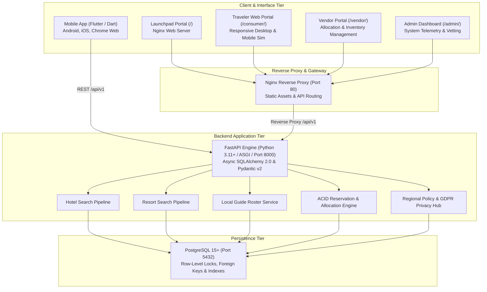

# Plan-E: End-to-End System Requirements Specification (SRS) & Detailed Technical PRD

**Document Version:** 2.0.0 (Granular Specification)  
**Status:** Approved / Active Baseline  
**Target Beta Scope:** 200 Concurrent Travelers, 50 Partner Properties, 30 Certified Local Guides  
**Host Architecture:** Linux (Pop!_OS 24.04 LTS) • Docker Compose • Constrained PC Hardware  

---

## 1. Executive Summary & Core Value Proposition

**Plan-E** is an asynchronous, high-concurrency Online Travel Agency (**OTA**) and experiential booking platform. The platform is architected from first principles to solve three foundational challenges in travel software:

1. **Dual-Journey Domain Separation:**
   * **City Hotels (Velocity-Driven):** Instant, low-friction transactional search optimized for short business trips and transit stays (geo-proximity sorting, date filters, 1-click booking).
   * **Sanctuary Resorts (Experiential Vacations):** Curated luxury imagery, experience filters, and resident tour guide rosters.
2. **First-Class Certified Local Guide Bundling:**
   * Proprietary composite reservation model allowing travelers to attach vetted, resident tour guides (credentials, languages, daily fees, and verified certifications) directly to their resort reservation in a unified checkout flow with atomic calendar locks.
3. **Guaranteed Zero-Overbooking Inventory Allocation:**
   * Avoids heavy, high-latency two-way GDS syncing for the MVP phase via a **Vendor Allocation Model** backed by PostgreSQL row-level pessimistic locking (`SELECT ... FOR UPDATE` with `CHECK (booked_count <= total_allocated)`).

---

## 2. System Architecture & Component Topology



---

## 3. Actor Profiles & User Personas

| Persona | Primary Interface | Permissions & Capabilities |
|:---|:---|:---|
| **Traveler (Consumer)** | Flutter App & Consumer Web (`/consumer/`) | Browse hotels/resorts/guides, view interactive maps, bundle guides, execute bookings, access My Trips, submit 5-star reviews, export personal data, anonymize account. |
| **Property Host (Vendor)** | Vendor Portal (`/vendor/`) | Configure room allocations, adjust nightly base/current rates, link resident guide roster, inspect occupancy metrics. |
| **Certified Guide** | Guides Roster / Vendor Affiliate | Display certifications, set daily/hourly rates, manage calendar availability, provide excursions. |
| **System Administrator** | Admin Dashboard (`/admin/`) | Platform fee adjustment, vendor approval, guide verification, telemetry diagnostics, audit logging. |

---

## 4. Detailed Functional Specifications: Conditions, Steps & Expected Outputs

---

### Feature 1: User Authentication & Session Management
* **Route:** `POST /api/v1/auth/login`
* **Subsystems Involved:** Backend (`auth.py`), Web Portals (`index.html`), Flutter (`app_state.dart`).

#### A. Preconditions & Input Criteria
1. User account must exist in the `users` table (`is_active = TRUE`).
2. Payload must contain valid RFC-5322 email and plaintext password.
   ```json
   {
     "email": "john.doe@example.com",
     "password": "Password123!"
   }
   ```

#### B. Execution Steps & Business Logic
1. **Validation:** Pydantic validates email format and non-empty password.
2. **Lookup:** Backend queries `SELECT * FROM users WHERE email = :email`.
3. **Password Verification:** Hashes provided password using Passlib / Bcrypt and verifies against stored `hashed_password`.
4. **Token Generation:** Generates JWT signed with `HS256`, containing:
   * `sub`: User UUID
   * `role`: User role (`TRAVELER`, `VENDOR`, `ADMIN`)
   * `exp`: Timestamp (default 7 days validity)
5. **State Persistence:** Client stores JWT in `localStorage` (`plane_user_token`) or Flutter secure storage.

#### C. Postconditions & Expected Outputs
* **Success Output (HTTP 200 OK):**
  ```json
  {
    "success": true,
    "message": "Authentication successful",
    "data": {
      "access_token": "eyJhbGciOi...",
      "token_type": "bearer",
      "user": {
        "id": "u1111111-...",
        "email": "john.doe@example.com",
        "full_name": "John Doe",
        "role": "TRAVELER"
      }
    }
  }
  ```
* **Failure Output (HTTP 401 Unauthorized):**
  ```json
  { "detail": "Incorrect email or password." }
  ```
* **UI Output:** Header updates to show user avatar and full name; Profile modal toggles from login form to authenticated user dashboard.

---

### Feature 2: City Hotel Search Pipeline
* **Route:** `GET /api/v1/hotels`
* **Query Parameters:** `city` (optional string), `min_price`, `max_price`, `min_rating`, `sort_by` (`price_low`, `price_high`, `rating`).

#### A. Preconditions & Input Criteria
1. Hotel records must exist with `property_type = 'HOTEL'` and `is_active = TRUE`.
2. Associated `room_types` must have active `room_allocations` for the requested date window.

#### B. Execution Steps & Business Logic
1. **Query Construction:** Builds asynchronous SQLAlchemy query against `properties` table joined with `room_types`.
2. **City Filtering:** Performs case-insensitive matching: `LOWER(city) LIKE :city%`.
3. **Price Calculation:** Derives `min_price_per_night` across active room types.
4. **Sorting:** Orders results by price or review score per `sort_by` parameter.
5. **Map Markers Synchronization:** Emits latitude, longitude, address, thumbnail, and starting rate for Leaflet / Mapbox canvas.

#### C. Postconditions & Expected Outputs
* **Success Output (HTTP 200 OK):**
  ```json
  {
    "success": true,
    "message": "Success",
    "data": [
      {
        "id": "h0000000-0000-0000-0000-000000000001",
        "name": "The Grand Bengaluru Metropolitan",
        "property_type": "HOTEL",
        "city": "Bangalore",
        "country": "India",
        "latitude": 12.9716,
        "longitude": 77.5946,
        "cover_image_url": "https://images.unsplash.com/photo-1566073771259-6a8506099945...",
        "star_rating": 4.8,
        "review_score": 4.8,
        "review_count": 142,
        "min_price_per_night": 125.00,
        "amenities": ["Fast Fiber WiFi", "24/7 Butler Service", "Rooftop Pool"]
      }
    ]
  }
  ```
* **UI Output:** Renders hotel cards with green *"Instant Hotel Booking"* pill, nightly price badge, and interactive map pins.

---

### Feature 3: Sanctuary Resort & Resident Guide Bundling Pipeline
* **Routes:** `GET /api/v1/resorts`, `GET /api/v1/guides`, `GET /api/v1/guides/{id}`

#### A. Preconditions & Input Criteria
1. Resorts must have `property_type = 'RESORT'`.
2. Guides must be certified (`is_verified = TRUE`) and optionally associated with resort properties.

#### B. Execution Steps & Business Logic
1. **Resort Discovery:** Fetches resorts with experiential amenities (Beachfront, Coral Reef, Spa, Private Villas).
2. **Resident Guide Loading:** For resort detail views, queries guides affiliated with the resort.
3. **Guide Selection:** Traveler clicks "Bundle Guide" (+$/day).
4. **State Linking:** Client stores `selectedGuide` object in checkout state.

#### C. Postconditions & Expected Outputs
* **Guide Profile Output (HTTP 200 OK):**
  ```json
  {
    "success": true,
    "data": {
      "id": "e0000000-0000-0000-0000-000000000001",
      "full_name": "Captain Kai Tanaka",
      "headline": "Certified Marine Biologist & Coastal Sailing Master",
      "daily_rate": 300.00,
      "rating": 4.98,
      "review_count": 86,
      "languages": ["English", "Japanese"],
      "specialties": ["Kelp Forest Snorkeling", "Whale Watching", "Sunset Sailing"],
      "is_verified": true
    }
  }
  ```
* **UI Output:** Resort detail modal displays bundled guide card; checkout sticky bar increments by guide daily rate.

---

### Feature 4: Pre-Checkout Quotation Engine
* **Route:** `POST /api/v1/bookings/quote`

#### A. Preconditions & Input Criteria
1. Valid `property_id` and at least one `room_type_id`.
2. `check_out_date` must be strictly greater than `check_in_date`.
3. Valid request payload:
   ```json
   {
     "property_id": "h0000000-...",
     "check_in_date": "2026-10-20",
     "check_out_date": "2026-10-23",
     "room_items": [{ "room_type_id": "r0000000-...", "rooms_count": 1 }],
     "guide_bundle": {
       "guide_id": "e0000000-...",
       "service_date": "2026-10-20",
       "duration_days": 1
     }
   }
   ```

#### B. Execution Steps & Business Logic
1. **Date Math:** Calculates `total_nights = check_out_date - check_in_date` (e.g. 3 nights).
2. **Room Calculation:** Multiplies room price per night by `rooms_count` and `total_nights`.
3. **Guide Fee:** Multiplies guide's `daily_rate` by `duration_days`.
4. **Platform Fee:** Calculates 5.0% platform commission on (room + guide) subtotal.
5. **Taxes:** Computes regional lodging tax (8.5% default exclusive mode).
6. **Total:** Computes `room_subtotal + guide_subtotal + platform_fee + tax_amount`.

#### C. Postconditions & Expected Outputs
* **Quote Output (HTTP 200 OK):**
  ```json
  {
    "success": true,
    "data": {
      "total_nights": 3,
      "room_subtotal": 375.00,
      "guide_subtotal": 300.00,
      "platform_fee": 33.75,
      "tax_amount": 57.38,
      "total_amount": 766.13,
      "currency": "USD",
      "is_available": true
    }
  }
  ```
* **UI Output:** Checkout summary renders itemized line items and updates button to *"Confirm & Pay $766.13"*.

---

### Feature 5: ACID-Compliant Atomic Reservation & Inventory Lock
* **Route:** `POST /api/v1/bookings`

#### A. Preconditions & Input Criteria
1. Traveler must be authenticated (`Authorization: Bearer <jwt>`).
2. Allocation records for specified room types must have `(booked_count + requested) <= total_allocated` across all dates in range.
3. If guide is bundled, guide must not have an existing confirmed booking on `service_date`.

#### B. Execution Steps & Business Logic
1. **Begin Transaction:** FastAPI begins explicit DB transaction.
2. **Row Lock Execution:**
   ```sql
   SELECT * FROM room_allocations 
   WHERE room_type_id = :room_id AND date BETWEEN :start AND :end 
   FOR UPDATE;
   ```
3. **Availability Validation:**
   * If any date has `booked_count + rooms_count > total_allocated`, throws HTTP 409 Conflict.
4. **Inventory Deduction:** Increments `booked_count = booked_count + rooms_count`.
5. **Guide Lock (if bundled):**
   ```sql
   SELECT * FROM guide_availabilities 
   WHERE guide_id = :guide_id AND date = :service_date 
   FOR UPDATE;
   ```
   * Flags `is_booked = TRUE`.
6. **Record Creation:** Generates parent `reservations` record with unique code (`RES-XXXXXX`), inserts child `room_booking_items` and `guide_booking_items`.
7. **Commit:** Commits transaction. If any step fails, automatic rollback occurs.

#### C. Postconditions & Expected Outputs
* **Success Output (HTTP 201 Created):**
  ```json
  {
    "success": true,
    "message": "Reservation confirmed successfully.",
    "data": {
      "id": "res-9e7d8a...",
      "reservation_code": "RES-8F291B",
      "property_id": "h0000000-...",
      "property_name": "The Grand Bengaluru Metropolitan",
      "status": "CONFIRMED",
      "payment_status": "PAID",
      "check_in_date": "2026-10-20",
      "check_out_date": "2026-10-23",
      "total_nights": 3,
      "guest_count": 2,
      "total_amount": 766.13,
      "currency": "USD"
    }
  }
  ```
* **Failure Output on Concurrency Conflict (HTTP 409 Conflict):**
  ```json
  { "detail": "Room allocation exhausted for the selected dates. Please choose another room." }
  ```
* **UI Output:** Checkout modal closes; Success modal opens showing reservation code; newly booked stay appears in My Trips.

---

### Feature 6: Cancellation & Automated Inventory Release
* **Route:** `POST /api/v1/bookings/{reservation_id}/cancel`

#### A. Preconditions & Input Criteria
1. Reservation must exist and belong to the authenticated user.
2. Status must be `CONFIRMED`. Cancelled bookings cannot be re-cancelled.

#### B. Execution Steps & Business Logic
1. **Authorization:** Checks `reservation.user_id == current_user.id`.
2. **Row Locking:** Acquires `FOR UPDATE` lock on associated allocations and guide records.
3. **Inventory Reinstatement:** Decrements `booked_count = booked_count - rooms_count` on all dates.
4. **Guide Release:** Sets `guide_availabilities.is_booked = FALSE`.
5. **Status Update:** Updates `reservation.status = 'CANCELLED'`.
6. **Commit:** Persists changes and triggers automated refund hook.

#### C. Postconditions & Expected Outputs
* **Success Output (HTTP 200 OK):**
  ```json
  {
    "success": true,
    "message": "Reservation cancelled successfully.",
    "data": { "id": "res-9e7d8a..." }
  }
  ```
* **UI Output:** Trip card in My Trips updates status tag to red *"CANCELLED"*, removes cancel button, and displays refund confirmation.

---

### Feature 7: Traveler Reviews & Star Ratings System
* **Route:** `POST /api/v1/reviews`

#### A. Preconditions & Input Criteria
1. Traveler must be authenticated.
2. Traveler must own the reservation specified in `reservation_id`.
3. Reservation status must not be `CANCELLED`.
4. Payload must satisfy:
   ```json
   {
     "reservation_id": "res-9e7d8a...",
     "property_id": "h0000000-...",
     "guide_id": null,
     "rating": 5,
     "comment": "Exceptional hospitality, pristine rooms, and fast Wi-Fi."
   }
   ```
   * `rating` must be an integer between 1 and 5 (inclusive).

#### B. Execution Steps & Business Logic
1. **Verification:** Validates reservation ownership and non-cancelled status.
2. **Review Insertion:** Inserts record into `reviews` table with `user_id = current_user.id`.
3. **Commit:** Commits transaction.

#### C. Postconditions & Expected Outputs
* **Success Output (HTTP 200 OK):**
  ```json
  {
    "success": true,
    "message": "Review submitted successfully.",
    "data": { "id": "rev-112233..." }
  }
  ```
* **UI Output:** Review modal closes; My Trips card swaps *"Write Review"* button for an amber badge *"Reviewed (5★)"*; toast notification confirms submission.

---

### Feature 8: Statutory Compliance & GDPR / CCPA Privacy Hub
* **Routes:** `GET /api/v1/compliance/policy`, `POST /api/v1/compliance/export-my-data`, `POST /api/v1/compliance/anonymize-my-account`

#### A. Preconditions & Input Criteria
1. For data export and account erasure, user must be authenticated.
2. For account anonymization, traveler must provide explicit user consent.

#### B. Execution Steps & Business Logic
1. **Data Portability (GDPR Art. 20):**
   * Joins and serializes user profile, all reservations (with room and guide items), and all reviews into machine-readable JSON.
2. **Right to Erasure / Anonymization (GDPR Art. 17):**
   * Generates anonymous hash ID (e.g. `anon_a8f9c2d1`).
   * Overwrites `email = "anonymized_anon_a8f9c2d1@deleted.invalid"`.
   * Overwrites `full_name = "Anonymized Traveler"`, `phone_number = NULL`, `is_active = FALSE`.
   * Preserves aggregate booking transaction amounts for statutory tax audit compliance.

#### C. Postconditions & Expected Outputs
* **Data Export Output (HTTP 200 OK):**
  ```json
  {
    "success": true,
    "message": "Personal data export generated successfully.",
    "data": {
      "profile": {
        "id": "u1111111-...",
        "email": "john.doe@example.com",
        "full_name": "John Doe",
        "role": "TRAVELER"
      },
      "reservations": [ /* itemized records */ ],
      "reviews": [ /* submitted reviews */ ],
      "data_processing_notice": "Data exported per statutory data subject rights request."
    }
  }
  ```
* **UI Output:**
  * Clicking "Export My Data" initiates browser download of `plane_traveler_data_export.json`.
  * Clicking "Delete & Anonymize" runs two-step confirmation, anonymizes DB record, clears localStorage, logs user out, and shows confirmation toast.

---

### Feature 9: Official Travel Voucher & Print Receipt Engine
* **Components:** `voucherModal`, `@media print` in [`web_portal/consumer/index.html`](file:///home/chakma-s/Desktop/Plan-E/web_portal/consumer/index.html).

#### A. Preconditions & Input Criteria
1. Traveler must have at least one confirmed booking in `myTripsSection`.

#### B. Execution Steps & Business Logic
1. **Data Population:** Reads booking reference, property name, room type, guest count, check-in date (2:00 PM), check-out date (11:00 AM), and bundled guide.
2. **QR Code Rendering:** Generates vector SVG check-in pass.
3. **Print Execution:** Traveler clicks "Print Voucher / Save PDF", triggering `window.print()`.
4. **CSS Isolation:** `@media print` rules hide `#appShell`, header ribbons, navbars, and backdrop overlays, displaying exclusively the white-background receipt voucher.

#### C. Postconditions & Expected Outputs
* **Physical / PDF Output:** Clean, single-page official voucher pass ready for front desk check-in presentation.

---

### Feature 10: Vendor Room Allocation & Inventory Management
* **Route:** `GET /api/v1/vendor/dashboard`, `POST /api/v1/vendor/allocations/batch-update`
* **Subsystems Involved:** Vendor Portal (`/vendor/index.html`), Backend (`vendor.py`), Database (`room_allocations`).

#### A. Preconditions & Input Criteria
1. Vendor must be authenticated with role `VENDOR` (`is_active = TRUE`).
2. Target property must be owned by the authenticated vendor (`property.vendor_id == current_user.id`).
3. Payload for allocation/rate adjustments:
   ```json
   {
     "property_id": "h0000000-0000-0000-0000-000000000001",
     "room_type_id": "r0000000-0000-0000-0000-000000000001",
     "start_date": "2026-11-01",
     "end_date": "2026-11-15",
     "total_allocated": 15,
     "base_rate_override": 145.00
   }
   ```
   * `total_allocated` cannot be less than currently `booked_count` for any date in the window.

#### B. Execution Steps & Business Logic
1. **Ownership Verification:** Validates that `property_id` belongs to `current_user.id`.
2. **Date Range Iteration:** Iterates through dates from `start_date` to `end_date`.
3. **Pessimistic Check:** Acquires row-level lock on existing allocation records.
4. **Integrity Rule Validation:**
   * If `total_allocated < existing.booked_count`, rejects transaction with HTTP 422 Unprocessable Entity.
5. **Upsert:** Updates `total_allocated` and `base_rate` (or inserts new rows if unallocated).
6. **Commit:** Commits transaction and writes audit trail.

#### C. Postconditions & Expected Outputs
* **Success Output (HTTP 200 OK):**
   ```json
   {
     "success": true,
     "message": "Allocations updated successfully for 15 dates.",
     "data": {
       "room_type_id": "r0000000-...",
       "total_allocated": 15,
       "rate": 145.00
     }
   }
   ```
* **Failure Output (HTTP 422 Unprocessable Entity):**
   ```json
   { "detail": "Cannot reduce allocation below existing booked count (currently 8 booked on 2026-11-04)." }
   ```
* **UI Output:** Vendor calendar grid reflects updated available capacity and new nightly rates.

---

### Feature 11: Admin Governance, Telemetry & Fee Modulation
* **Route:** `GET /api/v1/admin/overview`, `PATCH /api/v1/admin/settings/fees`
* **Subsystems Involved:** Admin Dashboard (`/admin/index.html`), Backend (`admin.py`).

#### A. Preconditions & Input Criteria
1. Caller must have role `ADMIN`.
2. Fee adjustment payload:
   ```json
   {
     "platform_fee_percentage": 6.5,
     "tax_exclusive_rate": 8.5
   }
   ```
   * `platform_fee_percentage` must be between 0.0 and 25.0.

#### B. Execution Steps & Business Logic
1. **Admin Authorization:** Verifies `current_user.role == "ADMIN"`.
2. **Telemetry Aggregation:** Compiles total confirmed bookings, gross merchandise value (GMV), active guide count, and database connection pool health.
3. **Fee Adjustment:** Updates dynamic configuration parameters in PostgreSQL `system_settings` table.
4. **Cache Invalidation:** Invalidates in-memory quote calculation fee cache.

#### C. Postconditions & Expected Outputs
* **Success Output (HTTP 200 OK):**
   ```json
   {
     "success": true,
     "message": "System fee parameters updated.",
     "data": {
       "platform_fee_percentage": 6.5,
       "tax_exclusive_rate": 8.5
     }
   }
   ```
* **UI Output:** Admin overview metrics refresh in real time; all subsequent `/api/v1/bookings/quote` queries immediately calculate using the new 6.5% commission rate.

---

### Feature 12: Consumer UI Interactive Controls & Edge Validation
* **Components:** Guest Stepper, Map Viewport Filter ("Search as I move"), Multi-Gateway Checkout Selector in [`web_portal/consumer/index.html`](file:///home/chakma-s/Desktop/Plan-E/web_portal/consumer/index.html).

#### A. Preconditions & Input Criteria
1. Traveler interacts with guest stepper (+/−) or map bounds.
2. Form constraints:
   * Adults must be strictly >= 1 and <= 10.
   * Children must be >= 0 and <= 8.
   * Total guests cannot exceed room capacity (default max 10 per single booking).

#### B. Execution Steps & Business Logic
1. **Guest Stepper Engine:**
   * Stepper clicks trigger `changeGuests(type, delta)`.
   * Enforces min/max boundaries; disables "-" button when Adults = 1 or Children = 0.
   * Updates guest count badge `#guestsCountText` (`"X Adults, Y Children"`).
2. **Map Viewport Filter ("Search as I move"):**
   * Leaflet map listens to `moveend` event.
   * If `#searchAsMapMovesCb` is checked, reads `leafletMap.getBounds()`.
   * Filters cached property list: `bounds.contains([p.latitude, p.longitude])`.
   * Rerenders property feed without network latency.
3. **Multi-Gateway Payment State Machine:**
   * Traveler selects payment method: `card`, `apple_pay`, `instant_gateway`.
   * Card gateway enforces 16-digit Luhn check, MM/YY expiration, and 3-digit CVV.
   * Digital Wallets display biometric simulated prompt.
   * Submit button locks to prevent double-submits (`btn.disabled = true; btn.innerHTML = "Processing..."`).

#### C. Postconditions & Expected Outputs
* **UI Output:** Clean responsive interaction, invalid inputs blocked with instant validation feedback, checkout submitted once with idempotency token.

---

## 5. Non-Functional Requirements (NFRs) & Constraints

| Category | Constraint / Metric | Enforcement Mechanism |
|:---|:---|:---|
| **P95 Latency** | < 150ms for search queries; < 50ms for detail views | Composite B-tree indexes on `(property_type, city, min_price)` |
| **ACID Integrity** | 0.00% double-booking under concurrent load | PostgreSQL pessimistic row locks (`SELECT FOR UPDATE`) + DB check constraints |
| **System Footprint** | Backend + PostgreSQL + Nginx <= 400 MB RAM | Non-root Alpine/Slim Docker images, zero standard QEMU Android emulator |
| **Mobile Simulation** | No PC freezing on constrained host | Flutter Web in Google Chrome (`Ctrl+Shift+M`) or Physical phone over USB + `scrcpy` |
| **Security Standards** | OWASP Top 10, CORS whitelist, CSP headers | JWT authentication, Pydantic validation, strict security headers |

---

## 6. Complete API Route & Schema Matrix

| Method | Endpoint | Auth Required | Input Schema | Success Output | Error Statuses |
|:---|:---|:---:|:---|:---|:---:|
| `POST` | `/api/v1/auth/login` | None | `LoginRequest` (email, password) | `TokenResponse` (jwt, user) | 400, 401 |
| `GET` | `/api/v1/hotels` | None | Query params (city, sort) | `List[HotelSummary]` | 422 |
| `GET` | `/api/v1/hotels/{id}` | None | Path `id` (UUID) | `HotelDetail` | 404 |
| `GET` | `/api/v1/resorts` | None | Query params (destination, sort) | `List[ResortSummary]` | 422 |
| `GET` | `/api/v1/resorts/{id}` | None | Path `id` (UUID) | `ResortDetail` | 404 |
| `GET` | `/api/v1/guides` | None | Query params (specialty, language) | `List[LocalGuideSummary]` | 422 |
| `GET` | `/api/v1/guides/{id}` | None | Path `id` (UUID) | `LocalGuideDetail` | 404 |
| `POST` | `/api/v1/bookings/quote` | None | `PriceQuoteRequest` | `PriceQuoteResponse` | 400, 404, 422 |
| `POST` | `/api/v1/bookings` | Bearer JWT | `ReservationCreateRequest` | `ReservationResponse` (201) | 400, 401, 409, 422 |
| `GET` | `/api/v1/bookings/my-reservations` | Bearer JWT | None | `List[ReservationResponse]` | 401 |
| `POST` | `/api/v1/bookings/{id}/cancel` | Bearer JWT | Path `id` (UUID) | `dict` (cancelled id) | 400, 401, 403, 404 |
| `POST` | `/api/v1/reviews` | Bearer JWT | `ReviewCreate` | `dict` (review id) | 400, 401, 404 |
| `GET` | `/api/v1/compliance/policy` | Optional | Header `x-region-code` | `RegionalPolicy` | None |
| `POST` | `/api/v1/compliance/export-my-data` | Bearer JWT | None | `Dict[str, Any]` | 401 |
| `POST` | `/api/v1/compliance/anonymize-my-account` | Bearer JWT | None | `dict` (status: anonymized) | 401 |
| `GET` | `/api/v1/vendor/dashboard` | Vendor JWT | None | `VendorDashboardData` | 401, 403 |
| `POST` | `/api/v1/vendor/allocations/batch-update` | Vendor JWT | `BatchAllocationUpdate` | `dict` (updated count) | 401, 403, 422 |
| `GET` | `/api/v1/admin/overview` | Admin JWT | None | `AdminTelemetryData` | 401, 403 |
| `PATCH` | `/api/v1/admin/settings/fees` | Admin JWT | `FeeSettingsUpdate` | `dict` (fee data) | 401, 403, 422 |

---

## 7. Edge Conditions, Concurrency Race Tests & Expected Outputs Matrix

| Scenario | Input Condition | Execution Step | Expected Backend Output | Expected UI / Client Output |
|:---|:---|:---|:---|:---|
| **Two Users Book Last Room Simultaneously** | 2 travelers initiate checkout for Room A on same dates when `total_allocated - booked_count = 1`. | Transactions enter `SELECT FOR UPDATE` queue. Winner executes first; second transaction unblocks and evaluates `booked_count + 1 > total_allocated`. | Winner: HTTP 201 Created.<br>Second: HTTP 409 Conflict. | Winner: Reservation confirmation modal.<br>Second: Error banner *"Room allocation exhausted for the selected dates."* |
| **Double-Click Checkout Button** | Traveler clicks "Confirm & Pay" multiple times within 500ms. | Client-side button disables immediately on first click (`disabled = true`); Backend idempotency key prevents duplicate execution. | First: HTTP 201 Created.<br>Duplicates: Blocked at client or HTTP 409. | Single charge; immediate transition to reservation voucher. |
| **Check-out Before Check-in** | `check_in_date = '2026-10-25'`, `check_out_date = '2026-10-23'`. | Pydantic validator checks `check_out_date > check_in_date`. | HTTP 422 Unprocessable Entity (`Check-out must be after check-in`). | Toast notification alerting date error; date pickers reset. |
| **Guide Bundling Overlap** | Traveler A books Guide X for 2026-10-20. Traveler B tries to book Guide X for same date. | Backend locks `guide_availabilities` row. Traveler A marks `is_booked = TRUE`. Traveler B query evaluates `is_booked == TRUE`. | Traveler A: HTTP 201.<br>Traveler B: HTTP 409 Conflict (`Guide unavailable`). | Traveler B receives alert suggesting alternative certified guides. |
| **Token Expiry During Checkout** | User opens checkout, waits 8 days until JWT expires, then clicks Pay. | FastAPI HTTPBearer dependency evaluates token expiration timestamp. | HTTP 401 Unauthorized (`Token has expired`). | Client clears expired session, opens Login Modal with message *"Session expired. Please log in to complete booking."* |
| **Cancellation After Prior Cancellation** | User sends multiple cancellation requests for same `reservation_id`. | Backend inspects `reservation.status`. | First: HTTP 200 OK.<br>Subsequent: HTTP 400 Bad Request (`Already cancelled`). | Trip status permanently displays CANCELLED; Cancel button disabled. |

